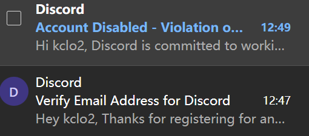

移除了下载安装限制，但是尚未申请到`PCL_CURSEFORGE_API_KEY`。当前不能完整使用。
很遗憾，在花了30分钟完成了上百道人机验证题目后，我的discord只用了两分钟就被封禁了。 **可能永远不会考虑接入curseforge**。

    
Hi kclo2,Discord is committed to worki

    Hi kclo2,

    Discord is committed to working to keep our community safe. We've found your account to be in violation of our Terms of Service or Community Guidelines. As a result, we've disabled your account for the following reason:

    Discord has disabled your account for spam and/or platform abuse. Our anti-abuse measures may have flagged your account for any of the following behaviors:

    Sending a large number of direct messages in a short span of time
    Participating in a server dedicated to spamming Discord
    Automating your user account or self-botting
    Taking other actions on Discord — for example, joining a ton of servers — faster than humanly possible
    Attempting potentially fraudulent activity
    Sincerely,
    Discord Trust & Safety

|API-Key|申请方法|
|  ----  | ----  |
|  `CURSEFORGE_API_KEY`   | https://support.curseforge.com/support/solutions/articles/9000208346-about-the-curseforge-api-and-how-to-apply-for-a-key  |
|`MS_CLIENT_ID`|https://xphost008.github.io/lmaml/SecondChapter/OAuthLogin.html|

https://portal.azure.cn/#blade/Microsoft_AAD_IAM/ActiveDirectoryMenuBlade/RegisteredAppsPreview

申请完成后，设置`CURSEFORGE_API_KEY`就可以正常使用本仓库提供的构建版本。

以下是旧的readme。

# Plain Craft Launcher

包含 PCL 的大部分源代码，包括 UI 库、动画模块、下载模块、Minecraft 启动模块等！ 
代码并不是实时更新的，它会在每次 PCL 发布更新时同步一次。 
非常感谢社区的大力支持！

 

### 相关资源
- [PCL 下载](https://meloong.com/pcl)：下载可免费使用的正式版 PCL！
- [PCL 功能投票](https://github.com/Meloong-Git/PCL/discussions/2)：来参加投票吧，开发者会优先处理票数较高的项目！
- [帮助文档库](https://github.com/LTCatt/PCL2Help)：PCL 内置帮助文档的存储库
